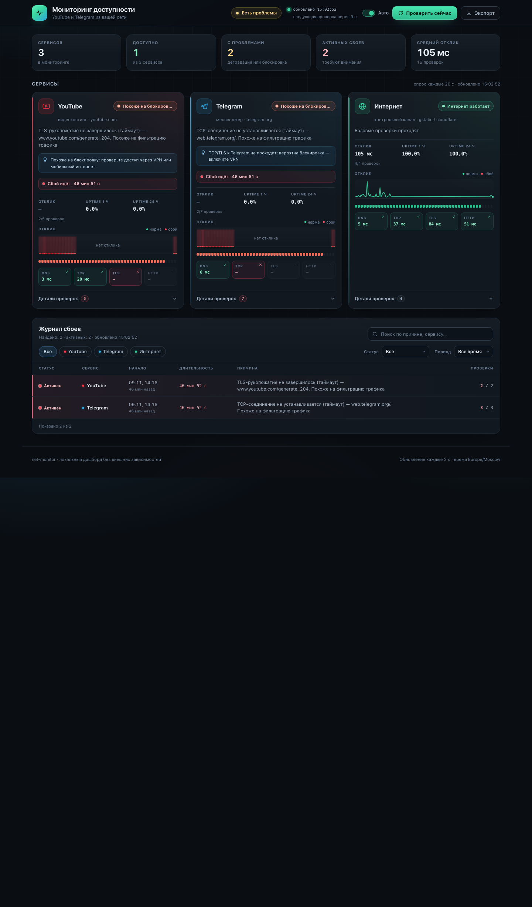

# net-availability-monitor

Cross-platform availability monitor for **YouTube** and **Telegram** with a local dashboard,
menu-bar/tray indicators and an Android app. Each check is split into stages
**DNS → TCP → TLS → HTTP**, so the app can tell “the service is down” from
“the connection is being filtered/blocked” (timeouts, resets, DNS failures) while the
control channel proves the internet itself is working.

English is the primary README. Русская версия — [README.ru.md](README.ru.md).

[](../../actions/workflows/ci.yml)
[](../../actions/workflows/ios.yml)
[](LICENSE)



## What it does

- checks **YouTube**, **Telegram** and a **control internet channel** every N seconds;
- classifies each service as `ok` / `degraded` / `blocked` / `down` / `unknown`;
- shows the failing stage and reason (e.g. “TLS handshake timed out — looks like DPI filtering”);
- keeps history, computes 1 h / 24 h uptime and opens **incidents** after 2 failed polls;
- provides a searchable incident log and JSON export;
- runs on macOS, Windows, Android and iPhone (iOS), all driven by one `config.json`.

## Platforms

| Platform | What you get | Install |
|---|---|---|
| **macOS** | Python server + browser dashboard + native menu-bar dot (Swift/AppKit), autostart via LaunchAgents | `./install.sh` |
| **Windows** | Python server + dashboard + system-tray dot, single `.exe` (PyInstaller), autostart via HKCU Run | `NetMonitor-windows-x64.zip` from Releases |
| **Android** | Native Kotlin/Compose app with its own checks, incident log, settings and notifications | `net-availability-monitor-android-<tag>.apk` from Releases |
| **iPhone (iOS 17+)** | Native SwiftUI app with its own staged checks, incident log, settings and local notifications | Xcode project in [`ios/`](ios/); build in Xcode or via GitHub Actions (unsigned simulator build; device/TestFlight install requires an Apple Developer account) |
| **Linux** | Python server + dashboard (tray optional, `tray.py`) | `python3 server.py` |

All platforms share the same [`config.json`](config.json): services, endpoints, timeouts,
polling interval, incident thresholds, status labels/colors and notification rules.

## macOS quick start

```bash
git clone https://github.com/bogatkin82-jpg/net-availability-monitor.git
cd net-availability-monitor
./install.sh
open http://127.0.0.1:8099/
```

`install.sh` builds the menu-bar app, installs it to `~/Applications/NetBar.app`, copies the
runtime to `~/Library/Application Support/netmon` (outside TCC-protected folders) and registers
two LaunchAgents so the server and the indicator start at login and recover after a crash.

If your browser uses a system HTTP proxy or VPN (Happ, corporate proxy), install with
`NETMON_PROXY=system ./install.sh` so the checks follow the same path as the browser; without it
the dot reflects the **direct** connection and may stay red while the browser works.

Menu-bar indicator modes (set in `config.json` → `display.macos_menubar.mode`):

- `overlay` — floating colored dot in the top-right corner, always visible above other windows;
- `dot` — compact dot inside the menu bar;
- `text` — `YT✓ TG✕`.

Left click opens the status menu, right click opens the dashboard, dragging moves the dot.

## Windows

**Recommended:** download `NetMonitor-Setup-x64.exe` from the latest Release and run it —
a per-user Inno Setup installer (no admin rights, Start Menu shortcuts, optional autostart,
uninstaller). Portable alternative: `NetMonitor-windows-x64.zip` with `NetMonitor.exe`
(signed), `config.json.example` and this guide.

The app starts the local server, shows a tray dot and opens the dashboard on demand.
The `.exe` and installer are Authenticode-signed with a **self-signed** certificate, so
SmartScreen may still warn until you trust the certificate (`netmon-code-signing.cer` is
attached to the release; see [docs/windows.md](docs/windows.md) for how to verify the
signature and add the certificate to Trusted Root).

## Android

Install the signed release APK `net-availability-monitor-android-<tag>.apk` from the latest
Release (allow installation from unknown sources), open the app and grant the notification
permission. The APK is signed with the project release key; its certificate SHA-256 is
`d368e63e3d0ea1bf7b5b0807f1244acee54595bf9f507b5ae2017b47633f4831`. `*.aab` is the same build
for releasing through Google Play.

The phone performs checks itself — no PC required. A foreground service keeps polling in the
background and shows a persistent **status icon next to the clock** (a monochrome glyph whose
shape encodes the state: ● ok, ▲ degraded, ⊘ blocked, ✕ down, ○ unknown). There are no separate
"status changed" notifications; the color status is visible in the notification shade, while the
status-bar tint is controlled by the system theme. Settings
(interval, thresholds, enabled services, notifications) are editable in the app and default to
`config.json`. See [docs/android.md](docs/android.md).

## Signed builds

- **Android:** the release APK/AAB is signed by the project release keystore (RSA-4096,
  10 000 days). The keystore and passwords live in GitHub Actions secrets
  (`ANDROID_KEYSTORE_BASE64`, `ANDROID_KEYSTORE_PASSWORD`, `ANDROID_KEY_ALIAS`,
  `ANDROID_KEY_PASSWORD`); CI verifies the signature with `apksigner` before publishing.
  `*.aab` is signed with the same key.
- **Windows:** `NetMonitor.exe` and the Inno Setup installer are Authenticode-signed in CI
  with a self-signed code-signing certificate (`WINDOWS_PFX_BASE64`,
  `WINDOWS_PFX_PASSWORD` secrets). The public certificate
  [`windows/netmon-code-signing.cer`](windows/netmon-code-signing.cer) is attached to every
  release. Verify on Windows:

  ```powershell
  Get-AuthenticodeSignature .\NetMonitor.exe | Format-List Status, SignerCertificate
  # add the certificate to Trusted Root to silence SmartScreen for this publisher:
  Import-Certificate -FilePath .\netmon-code-signing.cer -CertStoreLocation Cert:\CurrentUser\Root
  ```

  CI fails if signing is requested but the signature is missing; PR builds without secrets
  are unsigned.
- **Checksums:** every release contains `SHA256SUMS.txt` for the Windows artifacts; Android
  release SHA-256 is printed in the release notes.

## Nightly builds

Every night GitHub Actions builds `main` into a prerelease tagged
[`nightly`](https://github.com/bogatkin82-jpg/net-availability-monitor/releases/tag/nightly):
signed Windows `.exe`, installer, `SHA256SUMS.txt`, signed Android APK and AAB. You can also
trigger it manually (Actions → Android APK / Windows build → Run workflow → *nightly*).

## Configuration

`config.json` is the single source of truth. Schema: [`docs/config.schema.json`](docs/config.schema.json).

```jsonc
{
  "server": { "host": "127.0.0.1", "port": 8099 },
  "polling": { "interval_sec": 20, "check_timeout_sec": 8, "dns_timeout_sec": 4 },
  "incidents": { "open_after_failures": 2, "close_after_successes": 1, "max_stored": 500 },
  "history": { "max_age_hours": 24, "max_points": 8640, "series_points": 180 },
  "network": { "proxy": "direct" },
  "status_labels": { "ok": "Доступен", "blocked": "Похоже на блокировку", "...": "..." },
  "status_colors": { "ok": "#34c759", "degraded": "#ff9500", "blocked": "#ff3b30", "...": "..." },
  "services": [
    {
      "id": "youtube", "name": "YouTube", "accent": "#ff3040",
      "checks": [
        { "id": "yt_https", "kind": "https", "host": "www.youtube.com",
          "port": 443, "path": "/generate_204", "expect": [204],
          "core": true, "timeout": 8 }
      ]
    }
  ]
}
```

Validation and cross-platform parity:

```bash
python3 tools/check_config.py            # validate schema + Android asset parity
python3 tools/check_config.py --sync     # copy config.json into the Android assets
```

Server-side overrides: `--config PATH`, `--port`, `--interval`, `--proxy direct|system`;
env `NETMON_CONFIG`, `NETMON_PROXY`.

### Direct vs system proxy/VPN

By default every check opens a raw socket (DNS → TCP → TLS → HTTP) on the **direct** path.
That is what you want to detect filtering/blocking. If your browser reaches YouTube/Telegram
through a system HTTP proxy or VPN, set:

- `"network": { "proxy": "system" }` — auto-detect the OS proxy (macOS `scutil`, Windows
  Internet Settings, Linux `http(s)_proxy` / `all_proxy`) and tunnel checks through it with
  HTTP `CONNECT` (TLS/SNI and certificate validation are preserved);
- `"http://host:port"` — an explicit HTTP proxy;
- `"direct"` — raw sockets (default).

The override works too: `./server.py --proxy system` or `NETMON_PROXY=system`. `/api/state`
exposes `proxy: {mode, active, url}` and each check has `proxy_used`; the macOS indicator
shows the active proxy in its tooltip/menu. If a `system` proxy disappears, checks fall back
to direct so monitoring keeps working. Android already routes all traffic through the system
VPN (`tun`), so it ignores `network.proxy`.

## How statuses are computed

| Situation | Status |
|---|---|
| all core checks pass | `ok` |
| some core checks fail | `degraded` |
| all core fail, internet alive, TCP/TLS timeouts/resets or DNS failure | `blocked` — looks like filtering |
| all core fail with connection refused / HTTP error | `down` |
| control channel is down | `down` for every service |
| max successful core latency > 4 s | `degraded` |

Error codes are identical across platforms: `dns_error`, `dns_timeout`, `connect_timeout`,
`connect_refused`, `connect_unreachable`, `tls_handshake_timeout`, `tls_reset`,
`tls_cert_error`, `tls_error`, `read_timeout`, `http_status_unexpected`, `http_error`,
`unknown_error`.

## HTTP API

The Python server exposes a small JSON API (`/api/state`, `/api/incidents`, `/api/check`,
`/api/export`, `/api/health`) and serves the dashboard from `static/`.
Full contract: [docs/api-contract.md](docs/api-contract.md).

```bash
curl -s http://127.0.0.1:8099/api/state | python3 -m json.tool | head -40
curl -s 'http://127.0.0.1:8099/api/incidents?q=таймаут&service=telegram&status=active'
```

## Text UI, screenshots

| macOS overlay dot | Menu-bar dot | Dashboard | Mobile layout |
|---|---|---|---|
| [overlay](docs/screenshots/overlay.png) | [menubar](docs/screenshots/menubar.png) | [desktop](docs/screenshots/desktop.png) | [mobile](docs/screenshots/mobile.png) |

Android app on a real device (BKQ-AN90, Android API 37): [status screen](docs/screenshots/android.png) ·
[journal](docs/screenshots/android-journal.png) — 16/16 checks, YouTube reachable.
Status-bar indicator: [notification shade](docs/screenshots/android-notification.png) ·
[home screen icon](docs/screenshots/android-statusbar.png).


## Repository layout

```
config.json                 # shared settings for every platform
server.py                   # Python backend: checks, incidents, API, dashboard
static/                     # dashboard (vanilla HTML/CSS/JS, no build step)
tray.py                     # cross-platform tray indicator (Windows/Linux) with --selftest
menubar/NetBar.swift        # native macOS menu-bar app (Swift/AppKit)
windows/                    # PyInstaller entry, spec, install.ps1, build script
android/                    # Kotlin + Jetpack Compose application
tests/                      # Python tests (unit + API)
tools/check_config.py       # config validation and parity checks
docs/                       # API contract, architecture, per-platform guides, screenshots
.github/workflows/          # CI: config, Python, Swift, Windows exe, Android APK
```

## Development

```bash
python3 server.py --config config.json --port 8099     # run backend + dashboard
python3 tools/check_config.py                          # config lint
python3 -m pytest -q tests                             # Python tests

cd menubar && ./build.sh                               # macOS app (swiftc, no dependencies)
cd windows && pyinstaller netmon.spec                  # Windows exe (build on Windows)
cd android && ./gradlew test assembleDebug              # Android (JDK 17 + Android SDK)
```

CI builds every artifact and attaches them to GitHub Releases on `v*` tags:
`NetMonitor-windows-x64.zip`, `net-availability-monitor-android-<tag>.apk`.

## Verification

- `docs/qa-report-macos.md` — macOS acceptance report (API, incidents, UI via Chrome/CDP).
- `QA-REPORT-FINAL.md` — cross-platform parity and build verification before release.

## Disclaimer

`blocked` is a **heuristic** based on network symptoms (timeouts, resets, DNS failures).
The same symptoms can be caused by a broken server, Wi-Fi issue or VPN; that is why the
control channel is always checked. The project does not prove censorship and does not
circumvent it.

## License

MIT — see [LICENSE](LICENSE).
