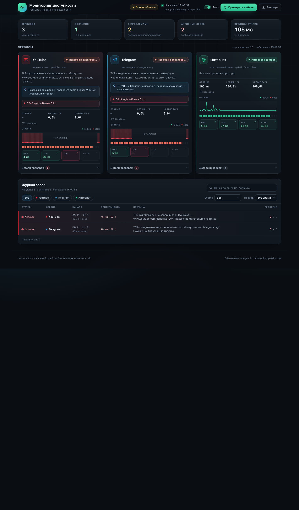

# net-availability-monitor

Кроссплатформенный монитор доступности **YouTube** и **Telegram**: локальный дашборд,
индикатор в меню-баре/трее и Android-приложение. Каждая проверка разложена на этапы
**DNS → TCP → TLS → HTTP**, поэтому видно, где именно ломается соединение, и можно
отличить «сервис недоступен» от «трафик фильтруется/блокируется», пока контрольный
канал подтверждает, что интернет в целом работает.

[English version](README.md)

[](../../actions/workflows/ci.yml)
[](LICENSE)



## Возможности

- проверяет **YouTube**, **Telegram** и **контрольный интернет-канал** каждые N секунд;
- классифицирует сервис как `ok` / `degraded` / `blocked` / `down` / `unknown`;
- показывает этап отказа и причину («TLS-рукопожатие не завершилось — похоже на DPI»);
- хранит историю, считает uptime за 1 ч / 24 ч и открывает **инциденты** после 2 неудачных опросов;
- журнал сбоев с поиском, фильтрами и экспортом в JSON;
- работает на macOS, Windows и Android по одному `config.json`.

## Платформы

| Платформа | Что даёт | Установка |
|---|---|---|
| **macOS** | Python-сервер + дашборд в браузере + нативная точка в меню-баре (Swift/AppKit), автозапуск через LaunchAgents | `./install.sh` |
| **Windows** | Python-сервер + дашборд + точка в системном трее, один `.exe` (PyInstaller), автозапуск через HKCU Run | `NetMonitor-windows-x64.zip` из Releases |
| **Android** | Нативное приложение Kotlin/Compose со своими проверками, журналом, настройками и уведомлениями | `net-availability-monitor-android-<тег>.apk` из Releases |
| **Linux** | Python-сервер + дашборд (трей опционально, `tray.py`) | `python3 server.py` |

Все платформы используют общий [`config.json`](config.json): сервисы, эндпоинты, таймауты,
интервал опроса, пороги инцидентов, подписи/цвета статусов и правила уведомлений.

## Быстрый старт на macOS

```bash
git clone https://github.com/net-availability-monitor/net-availability-monitor.git
cd net-availability-monitor
./install.sh
open http://127.0.0.1:8099/
```

`install.sh` собирает приложение меню-бара, ставит его в `~/Applications/NetBar.app`,
копирует рантайм в `~/Library/Application Support/netmon` (вне TCC-защищённых папок) и
регистрирует два LaunchAgent — сервер и индикатор поднимаются при входе и переживают падения.

Режимы индикатора (`config.json` → `display.macos_menubar.mode`):

- `overlay` — плавающая цветная точка в правом верхнем углу, всегда поверх окон;
- `dot` — компактная точка внутри строки меню;
- `text` — `YT✓ TG✕`.

Левый клик — меню статусов, правый — дашборд, перетаскивание — перенос точки.

## Windows

Скачайте `NetMonitor-windows-x64.zip` из последнего Release, распакуйте и запустите
`install.ps1` (PowerShell) или `NetMonitor.exe`. Приложение поднимает локальный сервер,
показывает точку в трее и открывает дашборд по клику. Автозапуск — одна запись в HKCU `Run`;
`uninstall.ps1` всё убирает. Подробности — в [docs/windows.md](docs/windows.md),
включая предупреждение SmartScreen (сборка без подписи).

## Android

Установите APK (`net-availability-monitor-android-<тег>.apk`) из последнего Release (разрешите установку из неизвестных
источников), откройте приложение и выдайте разрешение на уведомления. Телефон проверяет
сервисы сам — компьютер не нужен. Foreground-service продолжает опрос в фоне и уведомляет,
когда YouTube/Telegram становятся заблокированными или недоступными. Настройки (интервал,
пороги, включённые сервисы, уведомления) меняются в приложении, по умолчанию берутся из
`config.json`. Подробности — в [docs/android.md](docs/android.md).

## Настройки

`config.json` — единственный источник истины. Схема: [`docs/config.schema.json`](docs/config.schema.json).

```jsonc
{
  "server": { "host": "127.0.0.1", "port": 8099 },
  "polling": { "interval_sec": 20, "check_timeout_sec": 8, "dns_timeout_sec": 4 },
  "incidents": { "open_after_failures": 2, "close_after_successes": 1, "max_stored": 500 },
  "history": { "max_age_hours": 24, "max_points": 8640, "series_points": 180 },
  "status_labels": { "ok": "Доступен", "blocked": "Похоже на блокировку" },
  "status_colors": { "ok": "#34c759", "degraded": "#ff9500", "blocked": "#ff3b30" },
  "services": [
    {
      "id": "youtube", "name": "YouTube", "accent": "#ff3040",
      "checks": [
        { "id": "yt_https", "kind": "https", "host": "www.youtube.com",
          "port": 443, "path": "/generate_204", "expect": [204],
          "core": true, "timeout": 8 }
      ]
    }
  ]
}
```

Валидация и паритет между платформами:

```bash
python3 tools/check_config.py            # схема + совпадение Android-ассета
python3 tools/check_config.py --sync     # скопировать config.json в Android assets
```

Переопределения для сервера: `--config PATH`, `--port`, `--interval`; переменная `NETMON_CONFIG`.

## Как считаются статусы

| Ситуация | Статус |
|---|---|
| все core-проверки прошли | `ok` |
| часть core-проверок упала | `degraded` |
| все core упали, интернет жив, таймауты/сбросы TCP/TLS или ошибка DNS | `blocked` — похоже на фильтрацию |
| все core упали, соединение отклонено / HTTP-ошибка | `down` |
| контрольный канал недоступен | `down` у всех сервисов |
| максимальная успешная задержка core > 4 с | `degraded` |

Коды ошибок одинаковы на всех платформах: `dns_error`, `dns_timeout`, `connect_timeout`,
`connect_refused`, `connect_unreachable`, `tls_handshake_timeout`, `tls_reset`,
`tls_cert_error`, `tls_error`, `read_timeout`, `http_status_unexpected`, `http_error`,
`unknown_error`.

## HTTP API

Python-сервер отдаёт JSON API (`/api/state`, `/api/incidents`, `/api/check`, `/api/export`,
`/api/health`) и дашборд из `static/`. Полный контракт — [docs/api-contract.md](docs/api-contract.md).

```bash
curl -s http://127.0.0.1:8099/api/state | python3 -m json.tool | head -40
curl -s 'http://127.0.0.1:8099/api/incidents?q=таймаут&service=telegram&status=active'
```

## Скриншоты

| Точка поверх окон | Точка в меню-баре | Дашборд | Мобильная вёрстка |
|---|---|---|---|
| [overlay](docs/screenshots/overlay.png) | [menubar](docs/screenshots/menubar.png) | [desktop](docs/screenshots/desktop.png) | [mobile](docs/screenshots/mobile.png) |

## Структура репозитория

```
config.json                 # общие настройки для всех платформ
server.py                   # Python-бэкенд: проверки, инциденты, API, дашборд
static/                     # дашборд (vanilla HTML/CSS/JS, без сборки)
tray.py                     # трей (Windows/Linux) с режимом --selftest
menubar/NetBar.swift        # нативное приложение меню-бара macOS (Swift/AppKit)
windows/                    # PyInstaller entry, spec, install.ps1, скрипт сборки
android/                    # Kotlin + Jetpack Compose приложение
tests/                      # тесты Python (юнит + API)
tools/check_config.py       # валидация конфига и паритета
docs/                       # контракт API, архитектура, гайды, скриншоты
.github/workflows/          # CI: конфиг, Python, Swift, Windows exe, Android APK
```

## Разработка

```bash
python3 server.py --config config.json --port 8099     # бэкенд + дашборд
python3 tools/check_config.py                          # линт конфига
python3 -m pytest -q tests                             # тесты Python

cd menubar && ./build.sh                               # macOS-приложение (swiftc)
cd windows && pyinstaller netmon.spec                  # exe (собирать на Windows)
cd android && ./gradlew test assembleDebug              # Android (JDK 17 + Android SDK)
```

CI собирает артефакты и прикрепляет их к GitHub Releases на тегах `v*`:
`NetMonitor-windows-x64.zip`, `net-availability-monitor-android-<тег>.apk`.

## Проверка

- `docs/qa-report-macos.md` — приёмка macOS-версии (API, инциденты, UI через Chrome/CDP);
- `QA-REPORT-FINAL.md` — проверка паритета настроек и сборок перед релизом.

## Ограничения

`blocked` — **эвристика** по сетевым симптомам (таймауты, сбросы, ошибки DNS). Те же симптомы
бывают при упавшем сервере, проблемах Wi-Fi или VPN — поэтому всегда проверяется контрольный
канал. Проект не доказывает цензуру и не обходит блокировки.

## Лицензия

MIT — см. [LICENSE](LICENSE).
