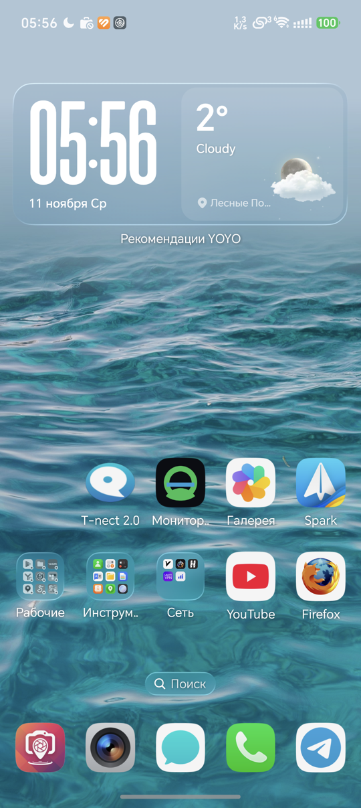
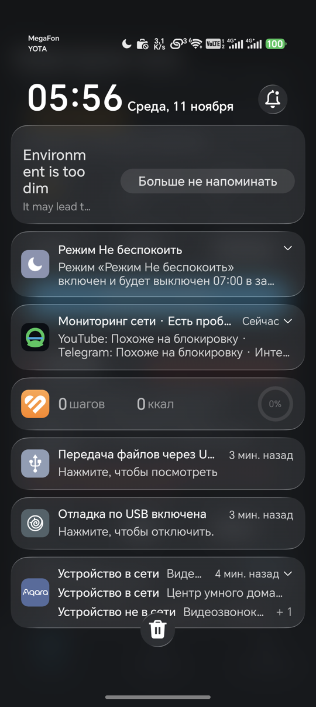

# Android-приложение «Мониторинг сети»

Нативное Android-приложение (Kotlin + Jetpack Compose) сетевого мониторинга:
проверяет доступность YouTube / Telegram / интернета, классифицирует состояние
(`ok / degraded / blocked / down / unknown`), ведёт историю, открывает инциденты
и уведомляет о сбоях.

Ключевое требование: **настройки те же, что в `config.json` в корне репозитория**
(сервисы и эндпоинты, интервал, таймауты, пороги инцидентов, статусы, цвета,
подсказки, уведомления). При сборке Gradle-таск `syncConfigJson` копирует
`../config.json` в `android/app/src/main/assets/config.json`, приложение читает
именно этот файл. Хардкода сервисов в Kotlin нет — только фолбэк-дефолты на случай
отсутствия файла, и они совпадают с `config.json` (проверяется `ConfigParityTest`).

---

## 1. Требования

* Android 8.0 (API 26) и новее, `compileSdk`/`targetSdk` = 35.
* Для сборки: JDK 17, Android SDK 35 (`platforms;android-35`, `build-tools;35.0.0`,
  `platform-tools`), Gradle 8.9 (wrapper в комплекте).
* Всё, что скачивается локально, складывается в `.toolchain/` (gitignored).
* `sdkmanager` на некоторых машинах не может скачать repository-манифесты
  (IO exception при записи в `~/.android`), поэтому `install-toolchain.sh`
  ставит SDK прямыми архивами с `dl.google.com` (platform-tools,
  platform-35_r02, build-tools_r35_macosx) и сам создаёт файлы лицензий.

## 2. Локальная сборка

```bash
cd net-availability-monitor
./.toolchain/install-toolchain.sh     # JDK 17 + Android SDK + Gradle 8.9 (один раз)

export JAVA_HOME="$PWD/.toolchain/jdk17"
export ANDROID_HOME="$PWD/.toolchain/android-sdk"
export ANDROID_SDK_ROOT="$ANDROID_HOME"
export GRADLE_USER_HOME="$PWD/.toolchain/gradle-home"   # кеш внутри репо
cd android
./gradlew test            # JVM unit-тесты
./gradlew assembleDebug   # APK
```

APK: `android/app/build/outputs/apk/debug/app-debug.apk`.

```bash
adb install -r android/app/build/outputs/apk/debug/app-debug.apk
```

`local.properties` с `sdk.dir=` создаётся локально и не коммитится
(в CI SDK подхватывается из `ANDROID_HOME`).

## 3. Установка и разрешения

| Разрешение | Зачем |
|---|---|
| `INTERNET` | сами проверки DNS/TCP/TLS/HTTP |
| `ACCESS_NETWORK_STATE` | состояние сети |
| `POST_NOTIFICATIONS` | уведомления (Android 13+; запрос при первом запуске) |
| `FOREGROUND_SERVICE` + `FOREGROUND_SERVICE_DATA_SYNC` | постоянное уведомление мониторинга |

После установки: разрешить уведомления (диалог на Android 13+). Для фоновой
работы используется foreground service с постоянным уведомлением — система
не «убивает» его как обычный фоновый процесс.

## 4. Что в приложении

* **Статус** — общий статус, KPI (сервисы/проблемы/инциденты/средний отклик/
  проверки/время обновления), карточки YouTube / Telegram / Интернет со статусом,
  причиной, подсказкой из конфига, откликом, uptime 1ч/24ч и полным списком
  проверок с этапами DNS/TCP/TLS/HTTP и временами. Кнопка «Проверить сейчас».
* **Журнал** — инциденты с поиском, фильтрами по сервису, статусу
  (активен/закрыт) и периоду (1ч/24ч/всё время).
* **Настройки** — интервал, таймауты проверки и DNS, пороги открытия/закрытия
  инцидентов, лимит хранения, включение сервисов, уведомления (вкл/выкл,
  `notify_on` по статусам, звук, вибрация), запуск/остановка foreground-сервиса,
  сброс истории. Сохраняется в SharedPreferences и сразу применяется к движку;
  дефолты — из `config.json`.
* **Автообновление** — экран обновляется каждые 3 с и запускает раунд проверок по
  интервалу из настроек; при уходе в фон цикл останавливается (lifecycle).
* **Фон** — foreground service «Мониторинг сети»: постоянное уведомление с текущим
  статусом, проверки по расписанию (минимум 15 с, корутина + `delay`, без
  WorkManager), системные уведомления при переходе в `blocked`/`down` по `notify_on`.

## 5. Движок проверок (паритет с `server.py`)

Чистый Kotlin без Android API (`ru.netmon.core`), поэтому тестируется на JVM:

1. `DNS` — `InetAddress.getAllByName` с жёстким таймаутом (daemon-поток);
   IP-литералы вида `149.154.167.51` не резолвятся (как в `server.py`).
2. `TCP` — `Socket.connect` с таймаутом.
3. `TLS` — `SSLSocket`, SNI (`SNIHostName`) и проверка hostname сертификата
   (`endpointIdentificationAlgorithm = "HTTPS"`).
4. `HTTP` — сырой `GET <path> HTTP/1.1` с `Host`/`UA`/`Connection: close`,
   ответ — первые 1024 байта, статус разбирается из первой строки.

Коды ошибок — те же, что на сервере: `dns_error`, `dns_timeout`, `connect_timeout`,
`connect_refused`, `connect_unreachable`, `tls_handshake_timeout`, `tls_reset`,
`tls_cert_error`, `tls_error`, `read_timeout`, `http_status_unexpected`,
`http_error`, `unknown_error`. Тайминги — `dns_ms/tcp_ms/tls_ms/http_ms`.

Классификация — построчный порт `Monitor._classify()`:
все core-проверки ok → `ok` (максимальная задержка core ≥ 4000 мс → `degraded`);
часть core ok → `degraded`; все core fail при живом интернете и блокирующих
ошибках TCP/TLS/timeout → `blocked`; только DNS-ошибки → `blocked`;
`refused`/HTTP-ошибки или недоступный интернет → `down`; нет данных → `unknown`.

Инциденты: открытие после N неудачных раундов, закрытие после M успешных,
`duration_sec`, хранение до `max_stored`, активные инциденты переживают рестарт.
История серий: `t/status/latency_ms`, uptime 1ч/24ч, срез последних
`series_points` точек, лимиты `max_age_hours`/`max_points`.

## 6. Отличия от macOS/Windows-версий

* Нет локального HTTP-сервера и порта `server.port` — приложение само является
  клиентом и UI; блок `server` в конфиге читается, но не используется.
* Нет menubar/tray-иконки; вместо неё — экран статуса и постоянное уведомление
  foreground-сервиса (аналог индикатора в трее).
* `display.macos_menubar` и `display.windows_tray` игнорируются;
  `notifications.windows` тоже (используется `notifications.android`).
* Пользовательские настройки в SharedPreferences перекрывают `config.json`;
  сброс приложения возвращает значения из конфига.

## 7. CI (GitHub Actions)

`.github/workflows/android.yml` на `ubuntu-latest`:
JDK 17 (`actions/setup-java`), Android SDK (`android-actions/setup-android@v3`),
`gradle/actions/setup-gradle@v4` (кеш Gradle), `./gradlew test assembleDebug`,
проверка `unzip -p ... assets/config.json` против корневого конфига,
артефакт `net-availability-monitor-android-debug`, на тег `v*` — GitHub Release
с APK (`softprops/action-gh-release`).

## 8. Ограничения

* Нет эмулятора/устройства в окружении разработки: UI проверен компиляцией,
  unit-тестами движка/конфига/инцидентов; Compose UI-тесты не запускались.
* Emu/device-зависимые вещи (реальная сеть, уведомления) в CI не проверяются.
* HTTP-клиент намеренно минимальный: HTTP/1.1, один запрос, редиректы не
  разворачиваются (это проверка доступности, а не браузер).
* DNS — системный резолвер Android; DoH/кастомный резолвер не используется.
* `minSdk 26`; foreground-сервис типа `dataSync` (интервал не чаще 15 с, есть
  кнопка «Стоп»). На Android 15 система ограничивает `dataSync`-сервисы временем
  работы (порядка 6 ч в сутки): для многодневного фона сервис нужно перезапускать,
  иначе проверки продолжатся только в UI при открытом приложении.
* `assets/config.json` — сгенерированная копия; руками её править не нужно.
  После правки корневого `config.json` пересоберите APK, чтобы настройки обновились.
* APK в CI — debug-подпись (release-подпись/Play-публикация не настроены).

## 9. Структура

```
android/
├── settings.gradle.kts / build.gradle.kts / gradle.properties
├── gradlew + gradle/wrapper/                    # Gradle 8.9
└── app/
    ├── build.gradle.kts                         # AGP 8.7.3, Kotlin 2.0.21, Compose BOM 2024.10.01
    └── src/
        ├── main/
        │   ├── AndroidManifest.xml
        │   ├── assets/config.json               # генерируется из корневого config.json при сборке
        │   ├── java/ru/netmon/core/             # движок: Json, Config, Checks, StagedChecker,
        │   │                                    #   Classifier, MonitorState, UserSettings
        │   └── java/ru/netmon/android/          # NetMonApp, MainActivity, prefs, controller
        │       ├── monitor/                     # MonitorController (раунды проверок)
        │       ├── service/                     # MonitorService (foreground), Notifications
        │       └── ui/                          # Compose: Theme, Components, Status/Journal/Settings, Root
        └── test/java/ru/netmon/core/            # JVM-тесты паритета и логики
```

Корневой `config.json` — единственный источник настроек: правишь его и
пересобираешь (`./gradlew assembleDebug`) — новые сервисы/эндпоинты/таймауты
попадут в APK без правок Kotlin-кода.

---

## Release-подпись

Release APK/AAB подписываются релизным keystore проекта (RSA-4096, срок 10 000 дней).
В CI keystore раскладывается из секретов:

- `ANDROID_KEYSTORE_BASE64` — base64 от `.jks`;
- `ANDROID_KEYSTORE_PASSWORD`, `ANDROID_KEY_ALIAS`, `ANDROID_KEY_PASSWORD`.

Перед публикацией CI проверяет подпись (`apksigner verify --print-certs`) и падает, если
сертификат не `CN=net-availability-monitor`. SHA-256 сертификата:
`d368e63e3d0ea1bf7b5b0807f1244acee54595bf9f507b5ae2017b47633f4831`.

Локальная подписанная сборка:

```bash
export ANDROID_KEYSTORE_PATH=/path/to/netmon-release.jks \
       ANDROID_KEYSTORE_PASSWORD=... ANDROID_KEY_ALIAS=netmon ANDROID_KEY_PASSWORD=...
./gradlew assembleRelease bundleRelease
```

## Проверки через системный прокси/VPN

`network.proxy` в `config.json`: `direct` (по умолчанию, сокеты напрямую), `system`
(системный HTTP-прокси — на Windows берётся из HKCU Internet Settings) или
`http://host:port`. Также `--proxy system` / `NETMON_PROXY=system`. В `/api/state` видно
`proxy` и `proxy_used` у проверок. Android использует системный VPN автоматически
(весь трафик идёт через `tun`), поэтому `network.proxy` не требует.

## Индикатор в строке состояния

Постоянное уведомление foreground-сервиса показывается иконкой рядом с часами. Android
рисует иконки строки состояния **монохромно**, поэтому цвет статуса недоступен; вместо
цвета меняется форма иконки:

| Статус | Иконка | Смысл |
|---|---|---|
| `ok` | ● | всё работает |
| `degraded` | ◐ | часть проверок не проходит / медленно |
| `blocked` | ⊘ | похоже на блокировку |
| `down` | ✕ | нет связи |
| `unknown` | ○ | проверок ещё не было |

Иконка показывает **худший** статус среди сервисов и контрольного канала — так же, как
цветная точка в menu bar macOS: блокировка → ⊘, нет связи → ✕, нестабильно → ◐.

Цвет статуса (из `status_colors` в `config.json`) показывается в шторке уведомлений:



Сервис включается переключателем «Индикатор статуса в строке состояния» в настройках и
автоматически при открытии приложения, если включён; после перезагрузки телефона его нужно
запустить снова (Android ограничивает фоновый автозапуск).

Если иконки не видно: некоторые прошивки (HONOR/MagicOS и др.) включают настройку
**«Скрывать тихие уведомления в строке состояния»** (`hideSilentStatusBar`). Приложение
использует канал с ресурсом тишины, чтобы уведомление не считалось «тихим», но если
прошивка всё равно скрывает — отключите эту настройку в системных настройках уведомлений
или откройте её кнопкой «Настройки уведомлений приложения» на экране настроек.

## Nightly

Каждую ночь workflow `Android APK` (cron `15 2 * * *`) публикует prerelease с тегом
`nightly` (APK + AAB). Вручную — Actions → Android APK → Run workflow → *nightly*.


## Проверено на реальном устройстве

- Устройство: **BKQ-AN90**, Android API 37 (Android 16), установка через `adb install`.
- Установлен подписанный release-APK v1.1.0 (versionCode 2); подпись установленного пакета
  совпадает с релизной (SHA-256 `d368e63e…33f4831`).
- Статус: 3/3 сервиса, 16/16 проверок, YouTube доступен, uptime 100% — см.
  [`docs/screenshots/android.png`](../docs/screenshots/android.png).
- Крашей в logcat нет.
